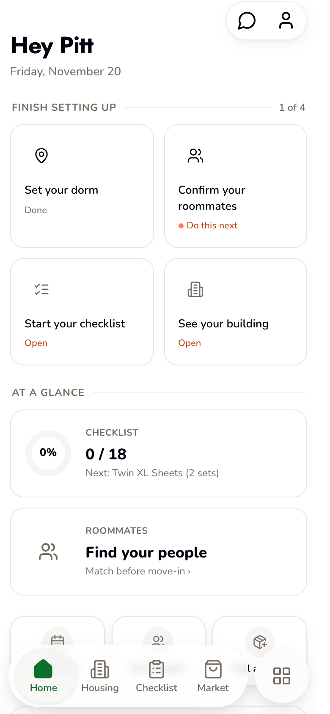
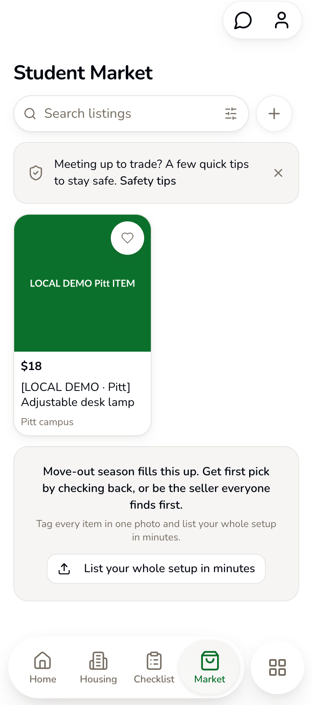
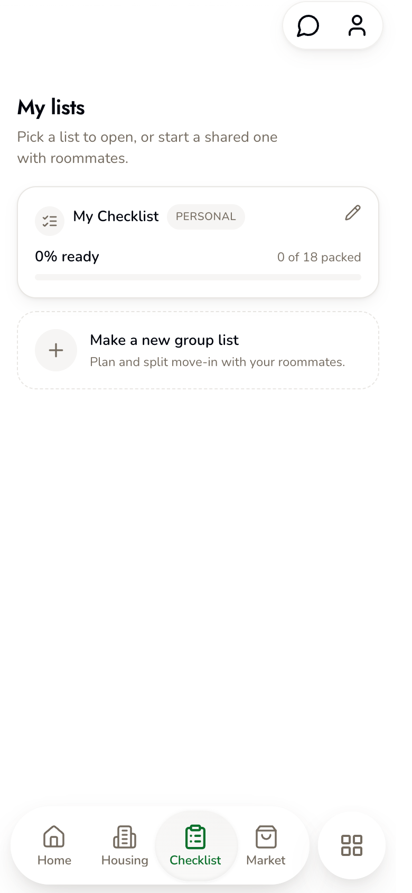

# DormCheck

A move-in, housing, and campus marketplace platform for college students, gated to verified
university email addresses. Built for the University of Pittsburgh and Carnegie Mellon.

> **Status: shelved Nov 2026, not live.** This repository is a read-only showcase of the
> source. It is not deployed, it does not accept contributions, and the hosted services it
> was built against have been shut down.

## What it is

DormCheck gave students one place to get through the year in a dorm: a shared move-in
checklist with their roommates, a student-only marketplace for buying and selling dorm
gear, sublease listings, direct messaging, and a housing explorer for their school.
Every account was verified through a school email, so the people on the other side of a
listing or message were other students at the same campus.

It reached **80+ student signups across Pitt and CMU** before it was shelved.

## Product walkthrough

From the campus home screen to buying dorm essentials and planning move-in. Click a screenshot to see it full size. All screens use fictional demo data.

| Campus home | Student marketplace | Move-in checklist |
| :---: | :---: | :---: |
| <a href="docs/screenshots/home.png"></a> | <a href="docs/screenshots/marketplace.png"></a> | <a href="docs/screenshots/checklist.png"></a> |
| Find housing, listings, and move-in tools. | Browse items from other students. | Organize tasks before move-in. |

## What Ethan built

Ethan Tran designed and built DormCheck end to end as a solo founder. Claude was used as an AI coding assistant.

- The product itself: a React + TypeScript web app that also ships as native iOS and
  Android apps from the same codebase.
- The backend: a multi-tenant Postgres schema on Supabase with row-level security on every
  table, so each university's data stays scoped to its own students.
- The infrastructure around it: transactional email, push notifications, image moderation,
  CI gates, release tooling, and test suites at every layer.
- The development workflow: a set of AI coding agents (Claude Code and Claude in Xcode)
  working in parallel under enforced lanes, gates, and a shared written journal. See
  [CLAUDE.md](CLAUDE.md).

## Architecture

| Layer | Stack |
|---|---|
| Client | React 19, TypeScript, Vite, Tailwind, shadcn/ui, TanStack Query, i18next |
| Native | Capacitor shells for iOS and Android, plus a native iMessage extension (Swift) |
| Backend | Supabase: Postgres with RLS, Auth, Realtime, Storage, Edge Functions (Deno) |
| API | Vercel serverless functions (`api/`) for email, notifications, and OG images |
| Maps | Mapbox GL |

Some details worth looking at:

- **Multi-tenancy in the database.** Every table is classified in
  `supabase/registry/table-classification.json` by how it is scoped to a university, and
  restrictive RLS policies enforce that scope. A CI check fails if a new table is missing
  from the registry or lacks policy coverage.
- **University email gating in four synced layers:** form validation, a client-side
  guard, a Postgres trigger, and the API. See `.claude/rules/auth-gating.md`.
- **Tests at each layer:** 169 unit test files (Vitest), 50 pgTAP database test files,
  32 Playwright end-to-end specs, and Edge Functions driven over HTTP against a local
  stack with mutation checks that prove each probe still catches its bug.
- **Migrations as history:** 222 forward-only SQL migrations, with a preflight script
  that refuses a destructive production apply without a recent backup confirmed from the
  Supabase API.

Full write-up: [docs/ARCHITECTURE.md](docs/ARCHITECTURE.md).

### Repository layout

```
src/                 React app (web, iOS, and Android share this)
api/                 Vercel serverless functions
supabase/migrations  Postgres schema history
supabase/functions   Edge Functions
supabase/tests       pgTAP database tests
ios/  android/       Capacitor native shells
e2e/                 Playwright specs
scripts/             Dev tooling: lanes, gates, seeding, release
docs/                Architecture and workflow docs
docs/ci-workflows/   The CI pipelines (kept inert in this showcase)
```

## Running it locally

You need Node 22+, Docker, and the Supabase CLI.

```bash
npm ci
cp .env.e2e.example .env.e2e
npx supabase init      # supabase/config.toml is not committed
npx supabase start
npm run demo:three-schools:seed
npm run dev
```

`.env.example` lists every environment variable. Only local demo keys are included in this
repository; there are no production credentials.

Native builds use `npm run build:ios` or `npm run build:android`. Signing configuration
(team IDs, provisioning, Firebase config) has been removed, so you will need your own to
run on a device.

## Brand

The brand color is DormCheck green, `#03C03C`.

## License

Copyright DormCheck LLC. All rights reserved. Source shared for viewing only. See
[LICENSE](LICENSE).
