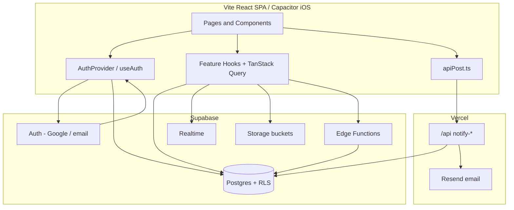

# DormCheck Architecture

Last generated: July 27, 2026, from commit `92ca927d` on branch `dev`.

<!-- verified-against: 4000f4a9 -->

The volatile inventories in this file (routes, edge functions, `/api` handlers, table
and view counts, platform build numbers) are **generated** — they live inside
`<!-- GENERATED:... -->` markers, `npm run docs:check` fails CI when they drift, and
`npm run docs:check -- --fix` rewrites them. Everything outside those markers is prose
written by a human and is the part worth reading.

<!-- GENERATED:platform-versions -->
| Platform | Marketing version | Build |
|---|---|---|
| iOS (`ios/App/App.xcodeproj`) | 1.01 | `CURRENT_PROJECT_VERSION` 32 |
| Android (`android/app/build.gradle`) | 1.01 | `versionCode` 3 |
<!-- /GENERATED:platform-versions -->

Source of truth for system architecture. Feature-level detail lives in `docs/audits/*.md` (reconciled at the same commit unless noted).

## 1. Overview

DormCheck is a student housing and campus-life platform. The product is a Vite 8 + React 19 + TypeScript single-page app that talks directly to Supabase (Postgres, Auth, Realtime, Storage, Edge Functions) for most data operations. Transactional email, cron jobs, and some notification orchestration run on Vercel serverless functions in `/api`. The same web bundle ships inside a Capacitor 8 native wrapper for **both** iOS (`ios/`, app id `com.dormcheck.ios`) and Android (`android/`, app id `com.dormcheck.android`).

**Multi-university, one schema.** The platform is no longer Pitt-only. There is a `universities` tenant registry and every campus-scoped row carries (or derives) a `university_id`; RLS keeps schools invisible to each other. Pitt is the pilot tenant, CMU is activated, and Carlow's activation is merged to `dev` (`20260921000000_activate_carlow_launch.sql`) but not yet applied to prod. Adding a school is a row in `universities`, never a new set of tables — there are no `pitt_*` tables and there never will be. **One read-side exception exists on `dev` and is not yet in prod:** `universities.marketplace_group` (`20260918000000`) lets co-located schools share marketplace READS while every write stays pinned to the author's own school — see `docs/schema-map.md` § "How the database is organized" and the 2026-08-16 entry in `docs/DECISIONS.md`. Full tenancy model: [`docs/schema-map.md`](schema-map.md) and [`docs/multi-university.md`](multi-university.md).

**Branches:** Active development on `dev`. Production web and native builds deploy from `main` (merge from `dev` only). iOS and Android work happens on `dev`, never a separate platform branch.

**Phase 1 pilot:** Non-admins see checklist, marketplace buy/sell, and DMs by default. Housing explore, roommates, campus map, room gallery, dorm rankings, and general group chats are hidden behind an admin-only client toggle (`LIMITED_SURFACES`; see section 10). Confirmed roommate groups and building/floor chats have since graduated *into* Phase 1. Phase 1 gating is UX-only, not a server security boundary.

## 2. Repository layout

```
Dormcheck/
├── android/                Capacitor Android project (Gradle, app id com.dormcheck.android)
├── api/                    Vercel serverless handlers; api/_lib/ shared, api/admin/, api/cron/
├── docs/                   Internal audits and reference docs (this file, docs/audits/)
├── e2e/                    Playwright end-to-end specs
├── ios/                    Capacitor iOS project (Xcode, App/, CapApp-SPM/)
├── public/                 Static assets served by Vite
├── scripts/                Maintenance, lane, release, audit and sync scripts (npm run targets)
├── src/                    React application source
│   ├── assets/             Images and static imports
│   ├── components/         UI by feature (checklist, dorm-portal, marketplace, admin/, ui/, etc.)
│   ├── config/             Universities registry / tenant config consumed by the client
│   ├── constants/          Shared constant values
│   ├── contexts/           React context providers (auth-adjacent, chat, collaboration, theme)
│   ├── data/               Static or seed data (move-in steps, advisories, mocks)
│   ├── design/             tokens.json — canonical design tokens (Tailwind + Figma sync read it)
│   ├── hooks/              Data-fetching and feature hooks (Supabase + TanStack Query), 69 modules
│   ├── i18n/               i18next setup, languages.ts, locales/ (en + zh)
│   ├── integrations/       Supabase client singleton and generated DB types
│   ├── lib/                Pure helpers (slugs, mapbox, auth, admin scopes, feature flags, apiPost)
│   ├── pages/              Route-level pages, split by zone: app/, auth/, admin/, advertiser/, marketing/
│   ├── routes/             Route trees per zone (AppRoutes, AuthRoutes, AdminRoutes, …) + path predicates
│   ├── test/               Vitest setup and shared test utilities
│   └── types/              App-level TypeScript types (Dorm, marketplace, etc.)
├── supabase/
│   ├── functions/          Deno Edge Functions (7, see §7)
│   ├── migrations/         Timestamped SQL migrations (schema source of truth)
│   ├── registry/           table-classification.json — machine-readable tenancy registry (test:db gate)
│   ├── snippets/           Ad hoc SQL snippets (not applied automatically)
│   └── tests/              pgTAP-style SQL tests for RPCs and policies
├── .design-sync/, ds-bundle/  Design-system sync to the claude.ai/design project
├── capacitor.config.ts     Capacitor app id, webDir, native plugin config
├── vercel.json             SPA rewrites, cache and security headers
├── vite.config.ts          Dev server (port 8080), @ alias, Capacitor base path
├── tailwind.config.ts      Reads src/design/tokens.json at build time (jiti)
└── package.json            npm scripts for dev, build, test, lanes, native sync
```

**Page/route zoning.** `src/pages/` is organized into the audience zones planned in
[`docs/architecture-zones-and-admin-tiers.md`](architecture-zones-and-admin-tiers.md) — `app/` (the
student product, the only zone the native builds ship), `auth/`, `marketing/`, `admin/`,
`advertiser/`. Each zone has a matching route tree in `src/routes/`; `src/App.tsx` composes them.

## 3. Routing and pages

Routes are no longer declared inline in `App.tsx`. `src/App.tsx` composes the zone route trees in `src/routes/`, each mounted inside `<BrowserRouter>`; heavy pages are `lazy()`-loaded.

<!-- GENERATED:routes -->
**6 zone route trees** in `src/routes/`.

| Route tree | Paths | Declared paths |
|---|---|---|
| `AdminRoutes.tsx` | 13 | `/admin/universities`, `/admin`, `/admin/dashboard`, `/admin/reports`, `/admin/team`, `/admin/activity`, `/admin/report`, `/admin/dorms`, `/admin/dorms/:id`, `/admin/platform`, `/admin/child-safety`, `/admin/ads`, `/admin/broadcast` |
| `AdvertiserRoutes.tsx` | 1 | `/advertise` |
| `AppRoutes.tsx` | 35 | `/my-home`, `/my-home/dorm`, `/notifications`, `/campus/:dormSlug`, `/campus`, `/map`, `/profile`, `/profile/edit`, `/profile/blocked`, `/settings`, `/account`, `/marketplace`, `/marketplace/create`, `/marketplace/my-items`, `/marketplace/edit/:id`, `/subleases`, `/subleases/create`, `/subleases/edit/:id`, `/roommates`, `/roommates/liked`, `/roommates/saved-posts`, `/rankings/invite/:code`, `/roommates/us`, `/roommates/invite/:code`, `/messages`, `/community`, `/housing`, `/housing/:slug`, `/gallery`, `/guide`, `/checklist`, `/logistics`, `/shop`, `/schedule`, `/campus-live` |
| `AuthRoutes.tsx` | 4 | `/select-school`, `/auth`, `/auth/v1/callback`, `/onboarding/intro` |
| `LegalRoutes.tsx` | 5 | `/privacy`, `/terms`, `/moderation`, `/licenses`, `/delete-account` |
| `MarketingRoutes.tsx` | 11 | `/`, `/features`, `/how-it-works`, `/for-students`, `/for-universities`, `/partners`, `/contact`, `/feedback`, `/about`, `/ads`, `/waitlist` |
<!-- /GENERATED:routes -->

The tables below annotate the same routes with what each page is for. Feature gating wraps housing, map, roommates, and rankings routes via `useFeatureFlags()` (Phase 1 gate; see section 10). Gating is **auth-first**: a logged-out visitor is bounced to `/auth` regardless of the flag, so the `ComingSoon` placeholder never leaks to anonymous traffic.

**`AppRoutes.tsx` — the student product (the only zone the native builds ship):**

| Route | Page | Purpose |
|-------|------|---------|
| `/my-home` | `app/MyHomePage.tsx` | Home dashboard with customizable widgets (protected) |
| `/my-home/dorm` | `DormHubPage` | "Your Dorm" hub (community, residents, building info) |
| `/notifications` | `NotificationsPage` | In-app notification feed |
| `/campus`, `/campus/:dormSlug` | `app/Index.tsx` | Housing explore (list, map tab, dorm detail panel) |
| `/housing`, `/housing/:slug` | `app/Index.tsx` / `HousingDetailPage` | Legacy housing paths |
| `/map` | `MapPage` | Full-screen Mapbox campus map |
| `/gallery` | `RoomGalleryPage` | Student room setup photo gallery |
| `/profile` | `ProfilePage` | Profile view; editing is now **inline** (`/profile/edit` redirects here) |
| `/profile/blocked` | `BlockedAccountsPage` | Manage blocked users |
| `/settings` | `SettingsPage` | Settings (appearance, notifications, security, legal). `/account` redirects here |
| `/marketplace` | `MarketplacePage` | Buy/sell |
| `/marketplace/create` | `MarketplaceCreatePage` | New listing (enters the pre-moderation pipeline) |
| `/marketplace/my-items` | `MarketplaceMyItemsPage` | Seller dashboard |
| `/marketplace/edit/:id` | `MarketplaceEditPage` | Edit listing |
| `/roommates`, `/roommates/liked`, `/roommates/saved-posts` | roommate pages | Roommate discovery (behind `SHOW_ROOMMATES`) |
| `/roommates/us` | `RoommateHubPage` | **Confirmed-group hub — Phase-1 reachable** (rides `SHOW_CONFIRMED_ROOMMATES`, not the discovery flag) |
| `/roommates/invite/:code` | `RoommateInvitePage` | Roommate-group invite accept (auth only, no flag) |
| `/community` | `CommunityPage` | Building + floor chat rooms (Phase-1 reachable) |
| `/rankings/invite/:code` | `RankingInvitePage` | Accept dorm ranking group invite |
| `/messages` | `MessagesPage` | DMs and group chats |
| `/schedule` | `SchedulePage` | Class schedule — restored 2026-08-26; route live, nav entries follow `showSchedule` |
| `/checklist` | `ChecklistOrLogisticsRedirect` → `app/ChecklistPage.tsx` | Move-in checklist and shop |
| `/logistics` | `LogisticsPage` | Move-in logistics wizard (split out of the checklist) |
| `/guide` | redirect | Redirects to `/checklist` |
| `/campus-live` | `CampusLivePage` | Campus information from university feeds (laundry, dining, key dates) |
| `/subleases` | `SubleasesPage` | Subleasing marketplace with map and listings |

**`AuthRoutes.tsx`:** `/select-school` (tenant picker), `/auth`, `/auth/v1/callback`, `/onboarding/intro`.

**`LegalRoutes.tsx`** (in the native app too, linked from Settings): `/privacy`, `/terms`, `/moderation`, `/licenses`, `/delete-account`.

**`MarketingRoutes.tsx`** (web only): `/`, `/for-students`, `/for-universities`, `/partners`, `/about`, `/contact`, `/feedback`, `/dorms`, `/ads`, `/waitlist`; `/features` and `/how-it-works` redirect.

**`AdminRoutes.tsx`:** `/admin` → `/admin/dashboard`, plus `/admin/team`, `/admin/activity`, `/admin/report`, `/admin/dorms`, `/admin/dorms/:id`, `/admin/broadcast`, and the superadmin-only `/admin/universities`, `/admin/reports`, `/admin/platform`, `/admin/ads`.

**`AdvertiserRoutes.tsx`:** `/advertise` (invite-gated advertiser portal).

Outside the zones: `/imessage` (`IMessageSharePage`), `/checklist/shared/:token` (`SharedChecklistPage`, account-less family/guest view), `*` → `NotFound`.

**Protected routes:** `ProtectedRoute` wraps onboarding, my-home, profile, settings, marketplace, messages, community, and all `/admin/*` routes. It checks **session presence only** — admin authorization is a separate layer (`RequireSuperAdmin` / scope checks, see section 6).

## 4. Major components

Central layout and chrome:

- `src/App.tsx` (~832 lines): providers, zone route composition, layout wrappers, feature gating
- `src/routes/*Routes.tsx`: the zone route trees (enumerated in §3) + `marketingPaths.ts` / `legalPaths.ts` predicates (also consumed by the theme resolver)
- `src/components/GlobalTopNav.tsx`, `NativeTopBar.tsx`, `BottomNav.tsx` (~1,129 lines): navigation
- `src/components/ProtectedRoute.tsx`: session gate for protected routes
- `src/components/ChatPanel.tsx` (~1,619 lines): inline messaging
- `src/components/MapView.tsx` (~1,617 lines): shared Mapbox map for explore
- `src/components/admin/AdminLayout.tsx` + `ViewAsBanner.tsx`: admin console shell and the superadmin "view as university_admin" POV banner

Feature-heavy components (line counts at this commit):

| File | Lines | Role |
|------|------:|------|
| `src/pages/app/ChecklistPage.tsx` | 3,654 | Checklist monolith (tabs, shop, group finance) — down from ~5,300 after the logistics split |
| `src/components/checklist/ChecklistExploreTab.tsx` | 2,243 | Checklist product explore |
| `src/hooks/useChecklist.ts` | 1,723 | Checklist data + realtime layer |
| `src/components/dorm-portal/StudentSetupsTab.tsx` | 1,696 | Room setup gallery tab |
| `src/components/housing/HousingRankingsContent.tsx` | 1,671 | Collaborative dorm rankings UI |
| `src/components/checklist/MoveInJourney.tsx` | 1,546 | Move-in journey / logistics UI |
| `src/pages/auth/Auth.tsx` | 1,514 | Auth page (native/web fork) |
| `src/pages/auth/OnboardingIntro.tsx` | 1,314 | Post-signup onboarding flow |
| `src/pages/app/MyHomePage.tsx` | 1,310 | Home dashboard |
| `src/components/dorm-portal/MarketplaceTab.tsx` | 1,284 | Marketplace embedded in housing explore |
| `src/pages/app/Index.tsx` | 1,120 | Housing explore shell |
| `src/pages/app/RoommatePage.tsx` | 1,107 | Roommate swipe and profile flows |

`src/integrations/supabase/types.ts` (4,898 lines) is generated — Grep it, never read it whole.

UI primitives live under `src/components/ui/` (shadcn/ui). Feature folders include `checklist/`, `dorm-portal/`, `marketplace/`, `roommate/`, `roommates/`, `explore/`, `my-home/`, `admin/`, `messages/`, `community/`, `nav/`, `pitt/`, `subleases/`.

**Unwired surfaces:** the previously-orphaned `CampusMapPage.tsx` and `FindingRoommates.tsx` have been **deleted**; `/campus-map` no longer exists anywhere. Remaining unwired inventory: `docs/audits/orphan-unwired.md`.

## 5. State and data fetching

**Supabase client:** singleton at `src/integrations/supabase/client.ts`, typed with `Database` from `src/integrations/supabase/types.ts`. Reads `VITE_SUPABASE_URL` and `VITE_SUPABASE_ANON_KEY`. Session persisted in `localStorage` with auto token refresh.

**TanStack Query:** `QueryClientProvider` wraps the app in `App.tsx`. Hooks such as `useDorms`, `useChecklist`, `useUserProfile`, and page-level queries use `useQuery` / `useQueryClient` for caching and invalidation.

**Custom hooks:** `src/hooks/` holds 74 hook modules (excluding tests). Pattern: hook encapsulates Supabase `.from()`, `.rpc()`, or Realtime `.channel()` subscriptions; components consume hook return values. Examples: `useDorms` (maps `master_housing` rows to app `Dorm` type), `useConversations`, `useChecklist`, `useBlockedUsers`, `useAnalytics`.

**Mutations:** mostly direct Supabase calls in components or hooks, with query invalidation afterward. Vercel `/api` POSTs go through `src/lib/apiPost.ts`, which attaches the user's JWT.

**Realtime:** Supabase channels used for DMs, group messages, checklist sync, marketplace listing changes, ranking updates, and unread counts (see `useConversations`, `useChecklist`, `ChatPanel`, etc.; `docs/audits/realtime.md`).

**React context:** nested providers in `App.tsx` (outermost to innermost): `QueryClientProvider`, `AccessibilityProvider` (wraps `MotionConfig`, resolving reduced-motion from the user preference rather than hardcoding `"user"`), `TooltipProvider`, `BrowserRouter`, `AuthProvider`, `ThemeProvider` (inside router + auth: route-scoped theming, per-user preference), `UniversityProvider`, `AdminPreviewProvider`, `AdminUniversitySiloProvider`, `SetupModeProvider`, `ModalOverlayProvider`, `CollaborationProvider`, `ChatProvider`, `HousingSavedProvider`, `BookmarksProvider`. Sub-trees add `NavShellProvider`, `GlobalSearchProvider`, and `ScrollEngagementProvider`.

**Theme:** `src/lib/theme.ts` is the single resolver. Preference is `'system' | 'light' | 'dark'` (stored under `dormcheck-theme`, persisted per user in `profiles.theme_preference`); `resolveEffectiveTheme()` is the only place `'system'` is resolved and route scoping applied. Dark mode is a **signed-in app-shell feature**: marketing, legal, `/auth`, `/select-school`, `/onboarding`, and `/admin` are always light (`isAlwaysLightPath()`). The inline FOUC script in `index.html` duplicates these rules because it cannot import modules — `src/test/theme.test.ts` pins the two together.

## 6. Auth

**Providers:** Google OAuth (primary UX) and email/password with OTP verification. This is **not** university SSO. Google sign-in uses an `hd=` domain hint on web (`supabase.auth.signInWithOAuth`) and `@capgo/capacitor-social-login` on native. In-app TOTP 2FA (native GoTrue `supabase.auth.mfa.*`) plus DormCheck-owned one-time backup codes (`mfa_backup_codes`, SHA-256 hashed client-side) and self-serve session listing/revocation.

**University email enforcement (layered).** The gate is **tenant-driven, not Pitt-hardcoded** — the school is resolved first (typed email, `?school=`, or session email) and gating runs against that university's domains. `src/lib/universityAuth.ts` deliberately has **no** default-university fallback: a silent Pitt default is what broke CMU sign-in on 2026-07-10.

| Layer | Mechanism | Scope |
|-------|-----------|-------|
| Auth form UX | Rejects a non-tenant domain before API calls | `pages/auth/Auth.tsx` handlers |
| Post-login client | `enforceUniversityEmailOrSignOut()` (`src/lib/universityAuth.ts`) | `Auth.tsx`, `AuthCallback.tsx` only |
| Database signup | `validate_university_email()` trigger (renamed from `validate_pitt_email()` in `20260710055958_generalize_email_gate`) | `BEFORE INSERT ON auth.users` only |
| Server-side `/api` | `isAllowedEmailDomain()` (`api/_lib/auth.ts`, hand-synced mirror of `ALLOWED_EMAIL_DOMAINS`), called from `getAuthedUser()` | handlers that call `getAuthedUser()` |
| Profile email immutability | `protect_profile_email()` trigger | `BEFORE UPDATE ON profiles`; blocks any change to `profiles.email` (does not re-validate the domain on other field updates) |

There is **no** global email-domain gate after login (`ProtectedRoute` checks session only). Most `/api` handlers re-check the domain via `getAuthedUser()` (see table above); a handful of public/cron/no-auth endpoints (`contact`, `og-image`, `og-invite`, `unsubscribe`, `join-waitlist`, `events`, `auth-methods`, `cron/*`) don't call it because they aren't user-authenticated. Edge Functions verify JWT identity but do not re-check the email domain (see `docs/audits/auth-and-access.md`).

**Admin RBAC (tiered, no longer a binary flag).** `profiles.role` is an `app_role` enum: `user` | `university_admin` | `superadmin`. `AuthProvider` exposes `role`, `universityId`, `isSuperAdmin`, `isUniversityAdmin`, `adminScopes`, and a legacy `isAdmin` (`role !== 'user'`). **`profiles.is_admin` is derived** — a trigger projects it from `profiles.role`, so direct writes to it are silently overwritten; always write `role`. Delegated capability scopes (`profiles.admin_scopes`) are checked client-side via `src/lib/adminScopes.ts`, which mirrors the DB helper `public.has_admin_scope` (`20260731020000`) — superadmins always pass. Superadmin-only routes are wrapped in `RequireSuperAdmin`; server-side, `admin-metrics` clamps the university param so a `university_admin` can only ever read their own school, and applies small-cell suppression to their view. The client checks remain UX; the DB/edge checks are the boundary.

**Session:** Supabase Auth JWT stored via client config (`persistSession: true`, `storage: localStorage`). `AuthProvider` (`src/hooks/useAuth.tsx`) listens to `onAuthStateChange`, re-reads `role`/`university_id`/`admin_scopes` on change, and exposes `user`, `session`, `isLoading`, `profileLoaded`, and `signOut`.

**Profile bootstrap:** on first session, `ensureProfile()` upserts a `profiles` row (covers OAuth race cases alongside DB trigger `handle_new_user` on `auth.users` INSERT). `is_admin` is fetched separately from `profiles` (own row only via RLS).

**Post-login redirect:** Web uses `getPostLoginRedirect()` → `/onboarding/intro` when `has_completed_onboarding` is false, else `/`. Native defaults to `/my-home` (skips onboarding redirect).

**OAuth redirect:** uses `VITE_SITE_URL` (fallback: `window.location.origin`) targeting `/auth/v1/callback`.

## 7. Data layer (Supabase)

> Tenancy classification of every table (how each is scoped per university, classes A–F): [`docs/schema-map.md`](schema-map.md). This section groups the same tables by feature domain.

### Main tables (by domain)

<!-- GENERATED:tables -->
**99 base tables** in schema `public` (22 A + 17 B + 21 C + 10 D + 2 E + 27 F), plus 6 views. Counted from `supabase/registry/table-classification.json`, which `npm run test:db` keeps honest.
<!-- /GENERATED:tables -->

The authoritative inventory + per-table tenancy class is `supabase/registry/table-classification.json` (machine-readable; `npm run test:db` fails on an unregistered table) and its human-readable mirror [`docs/schema-map.md`](schema-map.md). Grouped by feature domain:

**Tenancy registry:** `universities` (the tenant registry — `is_active` gates signups, `marketplace_group` opts into shared marketplace reads), `university_resources` (**repo-dropped, prod-live**: `20260820030000_drop_university_resources.sql` is merged but its prod apply halted at the backup gate on 2026-08-03, so a clean local replay has no such table while prod still does), `academic_terms`, `schools` / `school_domains` / `school_directory` (pre-tenant reference data), `university_waitlist`, `university_admin_leads`.

**Housing and campus data:** `master_housing` (canonical dorm records), `saved_dorms`, `dorm_questions`, `dorm_answers`, `dorm_question_upvotes`, `dorm_future_residents`, `dorm_edits` (admin audit trail), `explore_picks`, `buildings` (`is_subleasable` and `kind` columns added by `20260928000000` for sublease registry), `course_sections`, `user_classes`, `bus_stops`, `pogoh_station`. **Campus live feeds** (from scheduled ingests): `campus_data_sources`, `campus_ingest_cursor`, `campus_ingest_runs`, `campus_laundry_machines`, `campus_laundry_rooms`, `campus_dining_locations`, `campus_dining_hours`, `campus_dining_menus`, `campus_course_catalog`, `campus_academic_events`.

**Checklist and groups:** `checklist_items`, `checklist_item_claims`, `checklist_payments`, `checklist_payment_acks`, `checklist_share_links` (token links for a parent/guest to view and tick a group checklist — deliberately never grant group membership or expose money/PII), `ranking_collaborations`, `ranking_group_members`, `group_dorm_rankings`, `user_dorm_rankings`, `user_logistics_progress`, `payment_history`, `amazon_products`, `amazon_product_variations`, `saved_items`.

**Marketplace and subleases:** `marketplace_listings` (with `building_id` column for sublease listings, added by `20260928000000`), `marketplace_listing_items`, `marketplace_alerts` (saved searches that fan a notification on matching new listings), `listing_verifications` (owner-submitted proof, admin-reviewed; the buyer-visible flag is `marketplace_listings.verified_at`, set only by a SECURITY DEFINER trigger), `seller_ratings`, `business_listings`, `saved_businesses`, `saved_subleases` (legacy columns retained for backward compatibility).

**Roommates:** `roommate_search_posts`, `roommate_search_interests`, `favorite_roommates`.

**Messaging and community:** `conversations`, `messages`, `message_reactions`, `group_conversations`, `group_members`, `group_messages`, `group_message_reactions`, `community_room_optouts`, `blocked_users`, `device_tokens`, `notifications`.

**Profiles and account:** `profiles`, `profiles_public` / `profiles_roommate` (read-only projection tables behind the two directory views — see below), `mfa_backup_codes`, `user_home_location`, `deleted_accounts` (write-only audit log; service role only).

**Room setups:** `student_setups`, `setup_photos`, `setup_products`, `setup_comments`, `setup_comment_likes`, `setup_likes`. (The five dining tables were torn down in `20260613260000_teardown_dining_and_legacy_orphans` along with `favorite_listings`, `saved_roommates` and `saved_roommate_posts` — there is no dining data layer.)

**Admin, ops and messaging-out:** `admin_audit_log`, `admin_invitations`, `admin_email_log`, `push_broadcasts` + `broadcast_templates` (operator announcements; scheduling/templating is superadmin-only), `movein_push_log` (idempotency for the move-in countdown cron), `email_suppressions`, `api_rate_limits`, `moderation_actions`.

**Advertiser portal:** `advertisers`, `advertiser_invitations`, `ad_campaigns`, `ad_creatives`, `ad_impressions`. Advertiser accounts are **invite-gated** (a superadmin-issued invitation is the only way a business email registers, so the `.edu` signup gate stays airtight); campaign targeting is aggregate-only with a k-anonymity floor and never exposes student PII.

**Moderation and misc:** `content_reports`, `building_chat_links`, `building_chat_link_reports`, `analytics_events` (append-only pilot metrics; client INSERT own-row only, no client SELECT).

### Views

<!-- GENERATED:views -->
**6 views:** `marketplace_listings_contact`, `marketplace_public`, `public_profiles`, `roommate_profiles`, `roommate_search_posts_contact`, `seller_rating_stats`.
<!-- /GENERATED:views -->

- **`public_profiles`:** cross-user IDENTITY reads (DM/group/marketplace name + avatar). Since the Option B projection split (2026-07-20) it is a **`security_invoker` view over the read-only `profiles_public` projection table** (RLS: own row OR same-tenant OR — since `20260918000000`, on `dev` only — same `marketplace_group` via `shares_marketplace()`, OR superadmin; no opt-out filter, by decision, `docs/DECISIONS.md` 2026-08-16); this cleared its `security_definer_view` ERROR. Granted to `authenticated`/`service_role` only; revoked from `anon`. **3 columns exposed** (see below). Discovery/lifestyle data lives in **`roommate_profiles`** (36 columns, opt-out filtered + tenant-isolated; `security_invoker` view over `profiles_roommate`).
- **`marketplace_listings_contact`:** seller contact fields, gated to legitimate buyers.
- **`roommate_search_posts_contact`:** the same pattern for roommate posts.
- **`seller_rating_stats`:** aggregated seller rating stats.
- **`master_housing_map`** and **`collaboration_details`** no longer exist.

<!-- docs-drift-ignore: master_housing_map, collaboration_details, validate_pitt_email, delete_user_data, favorite_listings, saved_roommates, saved_roommate_posts -->
<!-- Named above only to record that they were REMOVED (or renamed, for
     validate_pitt_email -> validate_university_email). The drift guard would
     otherwise flag a doc for correctly saying a thing is gone. -->


#### `public_profiles` column policy

**Exposed to same-tenant authenticated users (3 columns, live prod verified 2026-07-20) — and, once `20260918000000` reaches prod, to authenticated users at any school in the same `marketplace_group`:** `id`, `full_name`, `avatar_url`. `instagram_username`/`snapchat_username` were deliberately removed by `20260814000000_directory_views_write_revoke_socials_trim` — the surface is kept to non-sensitive identity fields (the backing `profiles_public` RLS makes every column visible to same-tenant users), so do not add the socials back. Lifestyle/discovery/social columns are on `roommate_profiles` instead (opt-out filtered + tenant-isolated).

**Excluded (own-row via `profiles` RLS only):** `email`, `phone_number`, `venmo_username`, `zelle_info`, `is_admin`, `email_notifications`, `has_completed_onboarding`, `home_layout`, `current_floor`, `current_room`.

Cross-user phone on listings uses `marketplace_listings.phone_number`. Adding any column to `public_profiles` without review exposes it app-wide. Full RLS posture: `docs/audits/security-posture.md`.

### RLS posture (plain language)

RLS is enabled on user-data tables. `profiles` SELECT is restricted to the authenticated user's own row; other users are read through `public_profiles` or dedicated RPCs. Group checklist and payment data require **accepted** group membership. Messaging inserts respect block lists and conversation-request gates. `master_housing` is publicly readable; updates require an admin role.

**Tenant isolation** is the outer boundary and is enforced by RESTRICTIVE policies on `current_university_id()` for class-A roots (applied via `SELECT public.apply_tenant_isolation('public.<table>')`), inherited through the parent FK for class-B children, and derived from the owner's `profiles.university_id` for class-C user-owned rows. DMs and groups are **tenant-confined at creation** — no cross-campus edge can form, with one exception merged to `dev` and not yet applied to prod: `20260918000000` lets a 1:1 `conversations` row span two schools that share a `marketplace_group`, so a visible cross-school listing can be asked about. Consent is unchanged (`status` + `initiated_by` + `rls_conversations_insert_privacy_gate` still make it a request the recipient accepts), and group conversations were not widened. The six classes and every table's assignment: [`docs/schema-map.md`](schema-map.md).

**Marketplace pre-moderation (`20260719150000`).** A new listing is inserted as `status='pending_review'` and is hidden until it clears the pipeline; a status guard exempts `service_role` so only moderation can promote it. A blunt weapons/drugs/adult keyword block (`reject_prohibited_listing()` trigger) runs at INSERT, before a listing ever exists. See the `moderate-listing` edge function below.

**2026-06-13 hardening (still in force):** `marketplace_listings`, `student_setups`, and related setup tables are `authenticated`-only SELECT (anon revoked). Logged-out teasers use narrow SECURITY DEFINER preview RPCs. `dorm_questions`, `dorm_answers`, `dorm_question_upvotes` are authenticated-only with no preview RPC.

Security hardening migrations start at `20260525*`; tenant isolation lands in the `20260710*` series and the RBAC/scopes layer in `20260711*`–`20260731*`.

### RPCs (client-callable)

**80 functions** exposed on schema `public` as of this commit. Rebuilt from the generated
`Functions` block in `src/integrations/supabase/types.ts`, which is the oracle — PostgREST
exposes exactly what appears there. Args omit the `p_`-prefixed convention noise only where a
name is self-evident; `—` means the function takes no arguments. Several entries are RLS
*helpers* that the client never calls directly but which are exposed all the same; they are
marked **(helper)** so nobody mistakes reachability for intent.

| RPC | Args | Returns | Purpose |
|-----|------|---------|---------|
| `_create_notification` | `p_recipient`, `p_type`, `p_payload: Json` | `void` | **(helper)** Insert a row into `notifications`; called from triggers and other RPCs |
| `actor_is_superadmin` | `p_actor: uuid` | `boolean` | **(helper)** Whether a given user id holds the `superadmin` role |
| `admin_list_held_listings` | `p_university_id?` | setof record | Moderation queue of listings auto-held by `moderate-listing`, with owner and decision metadata |
| `am_i_in_group_with_user` | `target_user_id` | `boolean` | Whether caller shares an accepted ranking group with another user |
| `apply_tenant_isolation` | `p_table: regclass` | `void` | **(helper)** Migration-time installer for the RESTRICTIVE `current_university_id()` policy on a class-A table |
| `can_start_conversation` | `p_sender`, `p_recipient` | `boolean` | Whether a DM may be opened (block lists + conversation-request gate) |
| `check_group_access` | `check_group_id` | `boolean` | **(helper)** Whether caller may access a group's data |
| `check_rate_limit` | `p_bucket_key`, `p_max_requests`, `p_window_seconds` | `boolean` | Token-bucket limiter backed by `api_rate_limits`; returns false when the caller is over budget |
| `claim_pending_admin_invites` | — | `number` | On login, converts any `admin_invitations` matching the caller's email into a real role |
| `clear_group_checklist` | `target_group_id` | `void` | Remove all checklist rows for a group |
| `clear_group_pin` | `p_group_id` | `void` | Unpin the pinned message in a group chat |
| `clone_personal_to_group` | `target_group_id` | `void` | Copy the caller's personal checklist items into a group |
| `conversation_has_messages` | `conv_id` | `boolean` | **(helper)** Whether a conversation has any messages |
| `create_checklist_share_link` | `p_group_id`, `p_label?` | `text` (token) | Mint an account-less share token for `/checklist/shared/:token` |
| `create_ranking_group` | `p_group_name?`, `p_group_type?`, `p_dorm_name?`, `p_unit_label?`, `p_term?`, `p_member_ids?` | `uuid` | Create a dorm-ranking / roommate collaboration group and seed its members |
| `current_academic_year` | — | `text` | Current academic year string (e.g. `2026-2027`) |
| `current_app_role` | — | `app_role` | Caller's role enum (`user` / `university_admin` / `superadmin`) |
| `current_term` | `p_university_id` | `academic_terms` row | The tenant's in-progress term |
| `current_university_id` | — | `uuid` | **The tenant boundary helper** — caller's `university_id`; every RESTRICTIVE isolation policy is written against it |
| `decrement_product_hearts` | `product_id` | `void` | Decrement an Amazon product's heart count |
| `delete_group_message` | `p_message_id` | `void` | Soft-delete a group chat message (author or group RA) |
| `drop_all_policies_for_table` | `target_schema`, `target_table` | `void` | **(helper)** Migration-time policy reset; not for runtime use |
| `ensure_building_chat` | `b_id` | `uuid` | Get-or-create the building-wide chat room for a building |
| `ensure_floor_chat` | `b_id`, `p_floor` | `uuid` | Get-or-create the per-floor chat room for a building |
| `estimate_ad_reach` | `p_university`, `p_dorms?`, `p_class_years?` | `number` | Advertiser targeting estimate; aggregate-only with a k-anonymity floor, never row-level PII |
| `extract_listing_id` | `url` | `uuid` | Parse a marketplace listing id out of a pasted URL |
| `get_auth_methods_for_email` | `p_email` | `Json` | Which sign-in methods exist for an email; drives the progressive auth UI (also fronted by `api/auth-methods.ts`) |
| `get_blocked_relationship_user_ids` | — | `uuid[]` | Every user id in a block relationship with the caller, in either direction |
| `get_building_chat_links` | `b_id`, `year?` | setof record | Student-submitted external chat links (GroupMe/Discord) for a building, with report counts |
| `get_building_chats` | `b_id` | setof record | Building + floor chat rooms with membership and last-message info |
| `get_building_residents` | `b_id` | setof record | Residents of a building (identity fields only, `is_self` flagged) |
| `get_content_reports` | `content_type_filter?`, `p_university_id?` | setof record | Admin moderation queue across all reportable content, with previews and reporter info |
| `get_group_checklist` | `query_group_id` | setof `checklist_items` | Checklist items visible to accepted members of a group |
| `get_group_checklist_settlement_context` | `p_group_id` | `Json` | **Sensitive:** accepted members with `venmo_username` / `zelle_info`, plus group `payment_history` |
| `get_group_invite_preview` | `p_code` | setof record | Pre-join preview of an invite code (group name, dorm, member count, caller's status) |
| `get_groups_i_own` | — | `uuid[]` | **(helper)** Groups owned by the caller |
| `get_marketplace_preview` | `p_university_id?` | `Json` | SECURITY DEFINER anon teaser: up to 6 listings (narrow columns) + count |
| `get_my_accepted_group_ids` | — | `uuid[]` | **(helper)** Groups the caller has accepted into |
| `get_my_all_group_ids` | — | `uuid[]` | **(helper)** All groups the caller belongs to, pending included |
| `get_my_security_events` | — | `Json` | The caller's own recent security events for the Settings → Security panel |
| `get_my_sessions` | — | setof record | The caller's active sessions (IP, user agent, last seen, which one is current) |
| `get_setup_comment_likes` | `p_setup_id`, `p_author_id` | setof record | Like counts per comment on a room setup, plus liked-by-me / liked-by-author flags |
| `get_setups_preview` | `p_university_id?` | `Json` | SECURITY DEFINER anon teaser: setup count + recent photo URLs |
| `get_shared_checklist` | `p_token` | `Json` | Anon-callable read behind a checklist share token; identity-and-items only, never money or PII |
| `get_university_admins` | `p_university_id?` | setof record | Admin roster for a tenant (Admin → Team) |
| `get_waitlist_rank` | `p_domain` | `Json` | A waitlisted school's signup count / rank, for the waitlist confirmation screen |
| `has_accepted_conversation_between` | `u1`, `u2` | `boolean` | **(helper)** Whether two users already have an accepted DM thread |
| `has_admin_scope` | `p_scope` | `boolean` | Delegated-admin capability check (the RBAC scopes layer) |
| `has_advertiser_invitation` | `p_email` | `boolean` | Whether a business email holds a superadmin-issued advertiser invitation |
| `increment_product_hearts` | `product_id` | `void` | Increment an Amazon product's heart count |
| `is_advertiser_account` | — | `boolean` | **(helper)** Whether the caller is an advertiser rather than a student |
| `is_blocked_between` | `u1`, `u2` | `boolean` | **(helper)** Whether a block exists between two users |
| `is_chat_group_member` | `gid` | `boolean` | **(helper)** Group chat membership check |
| `is_conversation_blocked` | `conv_id` | `boolean` | **(helper)** Whether a DM conversation is blocked |
| `is_group_ra` | `p_group_id` | `boolean` | Whether the caller is the RA (moderator) of a community room |
| `is_superadmin` | — | `boolean` | **(helper)** Whether the caller is a superadmin |
| `join_group_via_invite` | `p_code` | `uuid` | Redeem a group invite code and return the joined group |
| `join_my_building_rooms` | — | `Json` | Auto-enroll the caller into the building + floor rooms implied by their profile |
| `mark_notifications_read` | `p_ids?` | `number` | Mark the given notifications (or all) read; returns the count updated |
| `next_term` | `p_university_id` | `academic_terms` row | The tenant's next upcoming term |
| `profile_university` | `p_user` | `uuid` | **(helper)** A user's `university_id`; the class-C tenancy derivation |
| `reorder_checklist_items` | `p_updates: Json` | `number` | Bulk-apply a drag-reorder as one statement; returns rows moved |
| `reset_checklist_custom` | `p_user_id` | `void` | Drop the user's custom checklist additions |
| `reset_checklist_defaults` | `p_user_id`, `p_list_type?` | `void` | Re-seed a user's checklist from the default template |
| `resolve_school_by_domain` | `p_domain` | `Json` | Anon-callable directory lookup: email domain → school + activation state (drives `/select-school`) |
| `revoke_admin_invitation` | `p_invite_id` | `void` | Cancel an unclaimed admin invitation |
| `revoke_checklist_share_link` | `p_token` | `void` | Kill a checklist share token |
| `revoke_my_other_sessions` | — | `number` | Sign the caller out everywhere except here |
| `revoke_my_session` | `p_session_id` | `boolean` | Sign out one specific session |
| `rotate_group_invite_code` | `p_group_id` | `text` | Issue a fresh invite code, invalidating the old one |
| `search_users` | `search_query` | setof record | DM / collaborator search — returns `id`, `full_name`, `avatar_url` only, never email |
| `seed_community_welcome` | `p_group_id`, `p_room_name` | `void` | Post the welcome message into a newly created community room |
| `set_admin_role` | `p_target_id`, `p_new_role: app_role` | `void` | Grant or change an admin role (superadmin only; writes `admin_audit_log`) |
| `set_group_member_ra` | `p_group_id`, `p_user_id`, `p_is_ra` | `void` | Promote/demote a community room RA |
| `set_group_pin` | `p_group_id`, `p_message_id` | `void` | Pin a message in a group chat |
| `set_shared_item_status` | `p_token`, `p_item_id`, `p_status` | `void` | Let a share-token holder tick a checklist item without an account |
| `set_university_feature_flags` | `p_university_id`, `p_flags: Json` | `Json` | Superadmin per-tenant feature-flag write |
| `sync_group_rankings_from_members` | `p_group_id` | `void` | Recompute a group's aggregate dorm ranking from its members' individual rankings |
| `use_backup_code` | `p_code` | `boolean` | Redeem a single-use MFA backup code |
| `user_current_dorm_matches_building` | `b_id` | `boolean` | **(helper)** Whether the caller's profile dorm matches a building id; gates building-room access |

Preview RPCs are consumed via `src/lib/publicPreviewRpcs.ts`. Internal **trigger** functions
(`handle_new_user`, `validate_university_email`, `protect_profile_email`, `reject_prohibited_listing`,
…) are not exposed on PostgREST, do not appear in the generated `Functions` block, and are
therefore deliberately absent from this table.

### Edge Functions

<!-- GENERATED:edge-functions -->
**10 Edge Functions** in `supabase/functions/` (excluding `_shared`): `admin-metrics`, `child-safety-evidence`, `delete-user-account`, `export-user-data`, `fetch-link-preview`, `held-listing-images`, `moderate-image`, `moderate-listing`, `send-auth-email`, `send-push`.
<!-- /GENERATED:edge-functions -->

| Function | Purpose |
|----------|---------|
| `admin-metrics` | Admin-only analytics; JWT (jose + JWKS) + role check; clamps the university param for `university_admin` and applies small-cell suppression; reads `analytics_events` |
| `delete-user-account` | App Store / Play account deletion; deletes auth user and owned data |
| `export-user-data` | GDPR/CCPA-style "download my data": caller's own profile, listings, roommate posts, conversations, messages, saved dorms. Caller id is always `payload.sub`, never client-supplied, and all reads run through a user-scoped client so RLS is a second guarantee |
| `moderate-listing` | Marketplace pre-publish auto-moderation (see below) |
| `send-auth-email` | Supabase `send_email` Auth Hook — renders **every** auth email through the shared DormCheck template and sends via Resend, so all product email is one brand. Signed with `SEND_EMAIL_HOOK_SECRET` (standardwebhooks), JWT verification off by design |
| `send-push` | Internal APNs/FCM dispatcher for native push (`SEND_PUSH_AUTH_TOKEN`) |
| `fetch-link-preview` | SSRF-hardened OpenGraph fetch for checklist URLs (gateway JWT) |

**`moderate-listing` pipeline** — hybrid and cost-optimized (near-$0 per listing), and **fail-closed**: any error holds the listing, so degraded moderation can never auto-approve.

1. **Stage 1 (free):** OpenAI omni-moderation over the text *and* every photo. Severe safety hit → reject; softer hit → hold.
2. **Stage 2 (free, in-code):** heuristic scam scan of the text. No signal → approve. This is the ~95% path and the reason the paid model rarely runs.
3. **Stage 3 (rare):** Claude Haiku judges a flagged listing for scam / off-platform / misleading — **text only**, since images already cleared stage 1, so no vision tokens. Measured ~$0.00056 per *flagged* listing, $0 for clean ones.

Outcomes map to listing status: approve → `available`, hold → `under_review`, reject → `rejected`. Admin surfaces for the held queue live at `/admin/reports` (`AutoHeldListingsPanel`).

Detail: `docs/audits/edge-functions.md`.

### Storage buckets

| Bucket | Use |
|--------|-----|
| `avatars` | Profile photos (user-scoped paths) |
| `marketplace-images` | Buy/sell listing photos |
| `roommate-post-photos` | Roommate search post images |
| `setup-photos` | Student room setup gallery |
| `business-banners`, `business-logos` | Student business listings |
| `dining-review-photos` | Dining review attachments (unwired `DiningRankings.tsx` only) |
| `dorm-photos` | Admin dorm editor images |
| `academic-planners` | Migration bucket; no upload UI; purged on account deletion |
| `listing-verifications` | **Private.** Lease/utility evidence for verified listings; owner-uploaded under their uid prefix, owner + admins read via signed URLs, never public |
| `images-quarantine` | **Private.** Rejected marketplace and content moderation images quarantined for review (added by `20261008000000`); no policies to prevent accidental leakage |
| `templates` | Admin-only broadcast/email template assets; 15 MB cap + MIME allowlist (hardened for advisor finding #43) |
| `dm-photos` | DM chat photos (`20260825000000`). Public-read like the other display buckets — a deliberate, stated tradeoff, since the app has no URL-signing path; writes are confined to the sender's own `<uid>/` prefix. 10 MB cap + image-only MIME list. Probe: `supabase/tests/dm_message_metadata_and_photos.test.sql` |

All wired *public* upload paths use `getPublicUrl`; `listing-verifications` is the exception and is read only through signed URLs. Detail: `docs/audits/storage-buckets.md`.

### Vercel `/api` handlers

All mutation/email handlers verify JWT via `api/_lib/auth.ts` (`getAuthedUser`). Shared email templates in `api/_lib/notifications.ts`. Recipients checked against `profiles.email_notifications` before send. Service-role client in `api/_lib/supabase.ts` (no anon fallback).

<!-- GENERATED:api-handlers -->
**34 Vercel `/api` handlers** (excluding the shared `api/_lib/` modules): `admin-invite.ts`, `admin/broadcast-templates.ts`, `admin/broadcast.ts`, `auth-methods.ts`, `contact.ts`, `cron/campus-calendar.ts`, `cron/campus-catalog.ts`, `cron/campus-dining.ts`, `cron/campus-laundry.ts`, `cron/dispatch-broadcasts.ts`, `cron/listing-freshness.ts`, `cron/movein-countdown.ts`, `cron/report-nudge.ts`, `cron/storage-sweep.ts`, `cron/weekly-digest.ts`, `events.ts`, `feedback.ts`, `join-waitlist.ts`, `notify-checklist-assigned.ts`, `notify-group-invite-accepted.ts`, `notify-listing-status.ts`, `notify-marketplace-inquiry.ts`, `notify-message-request-accepted.ts`, `notify-message-request.ts`, `notify-message.ts`, `notify-ranking-invite.ts`, `notify-school-launch.ts`, `notify-seller-rating.ts`, `og-image.ts`, `og-invite.ts`, `report-alert.ts`, `send-roommate-invite.ts`, `submit-admin-lead.ts`, `unsubscribe.ts`.
<!-- /GENERATED:api-handlers -->

| Handler | Purpose |
|---------|---------|
| `notify-message.ts` | New DM email (+ push via `_lib/push.ts`) |
| `notify-message-request.ts` | Conversation request notification |
| `notify-message-request-accepted.ts` | Request accepted notification |
| `notify-marketplace-inquiry.ts` | Marketplace buyer inquiry to seller |
| `notify-listing-status.ts` | Listing moderation outcome to the seller |
| `notify-seller-rating.ts` | New seller rating notification |
| `notify-checklist-assigned.ts` | Group-checklist item assigned to you |
| `notify-group-invite-accepted.ts` | Group invite accepted |
| `notify-ranking-invite.ts` | Ranking group invite email |
| `notify-school-launch.ts` | Waitlist → "your school is live" announcement |
| `send-roommate-invite.ts` | Housing/collaboration group invite |
| `join-waitlist.ts` | Waitlist capture for not-yet-active schools |
| `auth-methods.ts` | Which sign-in methods exist for an email (drives the auth UI) |
| `admin-invite.ts` | Superadmin-issued admin invitation |
| `contact.ts`, `feedback.ts` | Marketing contact form / user feedback to team inbox |
| `unsubscribe.ts` | One-click unsubscribe → `email_suppressions` |
| `events.ts` | Resend webhook (Svix signature via `RESEND_WEBHOOK_SECRET`) |
| `admin/broadcast.ts`, `admin/broadcast-templates.ts` | Operator push/email broadcasts and their templates (service role + server-side superadmin check) |
| `cron/dispatch-broadcasts.ts` | Sends scheduled broadcasts |
| `cron/movein-countdown.ts` | Move-in countdown push (idempotent via `movein_push_log`) |
| `cron/listing-freshness.ts` | Nudges/expires stale marketplace listings |
| `cron/report-nudge.ts` | Reminds admins about an aging moderation queue |
| `cron/weekly-digest.ts` | Weekly digest email |
| `cron/campus-calendar.ts` | Ingest university academic calendar into `campus_academic_events` |
| `cron/campus-catalog.ts` | Ingest university course catalog into `campus_course_catalog` and `course_sections` |
| `cron/campus-dining.ts` | Ingest university dining hours and menus into `campus_dining_locations`, `campus_dining_hours`, `campus_dining_menus` |
| `cron/campus-laundry.ts` | Ingest laundry machine status into `campus_laundry_rooms` and `campus_laundry_machines` |
| `og-invite.ts` | Dynamic OG tags for invite links (`/roommates/invite/:code`, `/rankings/invite/:code` via `vercel.json` rewrites); injects per-invite meta into the deployed `index.html`; generic card, never group membership |
| `og-image.ts` | `@vercel/og` edge function rendering the 1200×630 branded invite card (`?kind=&dorm=`) |

Detail: `docs/audits/api-surface.md`. Vite dev server does not serve `/api`; use `vercel dev` locally.

## 8. Data flow diagram



**Typical flows:**

1. **Sign in:** UI resolves the school → Supabase Auth (Google OAuth or email OTP, optionally a TOTP challenge) → session in localStorage → `useAuth` upserts `profiles` and reads `role`/`university_id` → `enforceUniversityEmailOrSignOut()` on auth pages → redirect to `/my-home` (native) or `getPostLoginRedirect()` (web). New signups also hit `validate_university_email()` on `auth.users` INSERT.
2. **Housing explore:** `useDorms` queries `master_housing` via TanStack Query (tenant RLS narrows it to the viewer's school) → `Index.tsx` renders list/map → dorm slug from `src/lib/dormSlug.ts`.
3. **Logged-out marketplace teaser:** `get_marketplace_preview` RPC returns narrow columns without auth.
4. **Checklist group settlement:** `useChecklistSettlementContext` calls RPC `get_group_checklist_settlement_context` → returns payment handles and ledger (not available via direct `profiles` read).
5. **Publishing a listing:** client inserts `status='pending_review'` → calls `moderate-listing` → the function verifies ownership and, via service role, sets `available` / `under_review` / `rejected`; `notify-listing-status` emails the seller.

## 9. Build and deploy

**Web:** `npm run dev` (port 8080), `npm run build` (output `dist/`), deployed to Vercel from `main`. `vercel.json` rewrites all non-API paths to `index.html` (SPA). Vercel Analytics and Speed Insights mounted in `App.tsx`.

**iOS:** `npm run build:ios` runs `CAPACITOR=1 vite build` (relative `base: "./"`) then `npx cap sync ios`. `npm run ios` also opens Xcode. Production iOS builds come from `main` after merge from `dev`. Tag every Archive on `main` with `npm run tag:ios`.

| Field | Value (`ios/App/App.xcodeproj/project.pbxproj`) |
|-------|--------------------------------------------------|
| Capacitor app id | `com.dormcheck.ios` |
| `MARKETING_VERSION` | 1.0 |
| `CURRENT_PROJECT_VERSION` | 30 |
| `IPHONEOS_DEPLOYMENT_TARGET` | 15.0 |

**Android:** the same bundle ships through a Capacitor Android project in `android/` (Gradle). Released to Google Play production.

| Field | Value (`android/app/build.gradle`) |
|-------|-------------------------------------|
| `applicationId` | `com.dormcheck.android` |
| `versionName` | 1.0 |
| `versionCode` | 2 |

**Environment variables (names only, never commit values):**

| Variable | Where |
|----------|-------|
| `VITE_SUPABASE_URL` | Client |
| `VITE_SUPABASE_ANON_KEY` | Client |
| `VITE_MAPBOX_TOKEN` | Client maps |
| `VITE_SITE_URL` | Client OAuth redirects |
| `VITE_API_BASE_URL` | Client `/api` base override (optional) |
| `VITE_E2E_*` | Local/e2e auto-login only, never prod (see `.env.e2e.example`) |
| `SUPABASE_URL` | `/api`, Edge Functions |
| `CRON_SECRET` | `/api/cron/*` (Vercel cron auth) |
| `SUPABASE_SERVICE_ROLE_KEY` | `/api`, Edge Functions (server only) |
| `RESEND_API_KEY` | `/api` email |
| `RESEND_WEBHOOK_SECRET` | `/api/events.ts` |
| `SEND_PUSH_AUTH_TOKEN` | Edge `send-push`, `/api/_lib/push.ts` |
| `ALLOWED_ORIGIN` / `ALLOWED_ORIGINS` | Edge function CORS (`admin-metrics`, `moderate-listing`) |
| `OPENAI_API_KEY` | Edge `moderate-listing` stage 1 |
| `ANTHROPIC_API_KEY` | Edge `moderate-listing` stage 3 |
| `SEND_EMAIL_HOOK_SECRET` | Edge `send-auth-email` (Supabase Auth webhook signature) |
| `APNS_ENV` and APNs signing vars | Edge `send-push` |
| `CAPACITOR` | Vite build flag for iOS bundle |

## 10. Conventions

**Imports:** `@/` alias maps to `src/` (configured in `vite.config.ts` and `tsconfig`).

**UI:** shadcn/ui primitives under `@/components/ui/`; reuse or extend a primitive before writing a new component. Shape is assigned by **role** via scarce radius tiers (`rounded-editorial` is reserved for a couple of surfaces per page; sheets/drawers sit in the card tier) — a primitive owns its tier and a size variant may not re-decide it. `npm run lint:glyphs` is a blocking gate for the `[&_svg]` cascade trap.

**Brand and tokens:** primary green `#03C03C` (= `malachite-600`); never hard-code a green hex, and use `malachite-800` for solid green fills on light backgrounds (AA). `src/design/tokens.json` is canonical — `tailwind.config.ts` reads it at build time, `src/index.css` holds the runtime CSS custom properties, and `scripts/sync-figma-tokens.mjs` pushes the same values to Figma. Light and dark are anchored **independently** (the Warm Neutral pass warms the light-mode neutral only). Typography: Nunito (`font-sans`), Jost (`font-display`), Fraunces (`font-serif`, marketing headlines), Sora (`font-wordmark`, logo).

**i18n:** i18next, `src/i18n/`. `I18N_LANGUAGE_PICKER` is on (Settings → Appearance); only languages flagged `enabled` in `src/i18n/languages.ts` reach students, so incomplete locales stay hidden even with the picker on. English and Chinese (zh) are complete.

**Responsive:** mobile-first unprefixed classes are the iOS baseline. Desktop overrides use `md:` / `lg:`. Breakpoint hook: `useIsMobile()` at 768px (`src/hooks/use-mobile.tsx`).

**Routing:** dorm URLs use kebab-case slugs from `dormSlugFromName()` in `src/lib/dormSlug.ts`.

**Feature gating:** `LIMITED_SURFACES = true` in `src/lib/featureFlags.ts` drives the gate (renamed from `PHASE_1_ONLY` 2026-08-06 — pure rename, the pilot the old name named is gone), and the derived flags `SHOW_HOUSING` / `SHOW_ROOMMATES` remain `!LIMITED_SURFACES`. Housing is nonetheless reachable in practice: Pitt carries the per-surface override `features: { showHousing: true }` in `src/config/universities.ts`, so the dorm portal and its reviews open while Roommates/Map/Rankings/Saved Dorms stay off. Admins can toggle full app preview via `AdminPreviewContext` (`localStorage` key `dc_admin_full_app_preview`); `resolveFeatureFlags()` requires `isAdmin` AND the toggle for `showFullApp`. Three surfaces sit on their own flags and no longer follow the master gate: `SHOW_CONFIRMED_ROOMMATES` (invite/accept groups + checklist integration — roommate *browsing* stays gated), `SHOW_BUILDING_CHATS` (building and floor chats in the Your Dorm hub — general group chats stay gated), and `I18N_LANGUAGE_PICKER`. Other independent gates: `SHOW_STUDENT_BUSINESSES = false`. (`SHOW_LANDING_TESTIMONIALS` was removed 2026-08-02 together with the placeholder-quote section it gated — fabricated social proof does not get a flag.) Detail: `docs/audits/feature-flags-phase-1.md`.

**Amazon affiliate:** product links must include `tag=dormcheck-20` (see `src/lib/amazonAffiliateUrl.ts`).

**Maps:** react-map-gl / mapbox-gl only; token from `VITE_MAPBOX_TOKEN`.

**Commits:** conventional commits; do not push from automation (project rule).

## 11. Known debt and hotspots

**ChecklistPage monolith (~3,654 lines):** still owns shop, checklist, group management, and finance UI. Down from ~5,300 after `/logistics` split out, but high change risk; audit before editing.

**Other large files:** `ChecklistExploreTab.tsx` (~2,243), `useChecklist.ts` (~1,723), `StudentSetupsTab.tsx` (~1,696), `HousingRankingsContent.tsx` (~1,671), `ChatPanel.tsx` (~1,619), `MapView.tsx` (~1,617), `MoveInJourney.tsx` (~1,546), `Auth.tsx` (~1,514, native/web fork), `OnboardingIntro.tsx` (~1,314), `BottomNav.tsx` (~1,129).

**Orphan surfaces:** `CampusMapPage.tsx`, `/campus-map`, and `FindingRoommates.tsx` were deleted and are no longer debt. One legacy table with no client consumer remains: `saved_subleases`. (`favorite_listings`, `saved_roommates` and `saved_roommate_posts` were listed here as surviving debt but were in fact dropped in `20260613260000_teardown_dining_and_legacy_orphans` — that debt is already paid.) See `docs/audits/orphan-unwired.md`.

**Client-only gates:** UI admin checks, feature flags, and email-domain enforcement on auth pages are not authorization. Internet-reachable endpoints must re-verify JWT and business rules (`docs/security-todo.md`). Note also that `profiles.is_admin` is a *derived* projection of `profiles.role` — writing it directly is silently reverted.

**Typecheck baseline is noisy:** `tsc -b` carries a large pre-existing error count on `dev`. The real blocking gates are `build`, `lint`, and `test`; compare against the baseline rather than expecting zero.

**public_profiles exposure:** intentional cross-user read surface, identity-only (id, full_name, avatar_url). New columns on `profiles` do not automatically belong on the view; confirm exposure before adding. Social handles were removed from it (`20260814000000`) — they flow through `roommate_profiles` only.

**Realtime channel proliferation:** many ad hoc channel names across hooks and components; duplicate subscriptions possible on heavy pages (`docs/audits/realtime.md`).

**iOS push entitlements are now split by configuration:** Debug uses `App/App.entitlements` (`aps-environment = development`), Release uses `App/AppRelease.entitlements` (`production`). The edge `APNS_ENV` still **defaults to `sandbox`** when unset, so the environment variable must be set explicitly for production APNs (`docs/audits/capacitor-native.md`).

**Sparse TODO/FIXME in src:** broader debt is structural (file size, unwired UI) rather than marked TODOs.

**Pre-existing build noise:** Vite chunk size warnings after production build are known and not treated as failures.

**Audit index:** per-feature shipped state in `docs/audits/_coverage.md`. Security RLS/RPC detail in `docs/audits/security-posture.md`.
